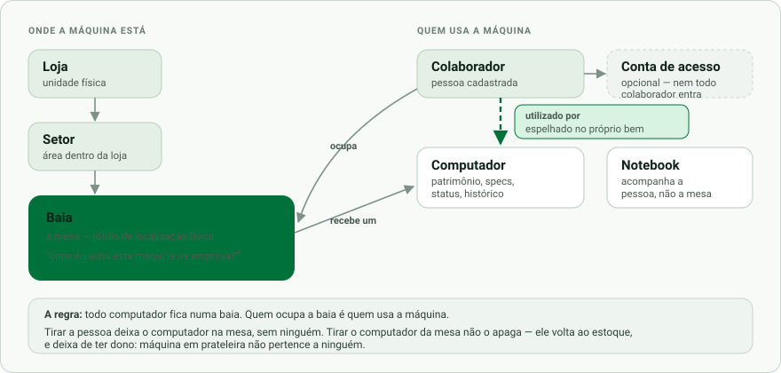

<div align="center">

# PatriMap

**Gestão de ativos de TI para uma rede de lojas** — onde está cada máquina,
quem usa, como ela está, e o que já aconteceu com ela.

Django 5.2 · Python 3.12 · SQLite (WAL) · Material Design 3

<br>



</div>

---

Este repositório é uma **vitrine da arquitetura**. O sistema roda em produção
numa rede com 6 lojas, ~130 computadores e ~30 notebooks; o código de produção
e os dados são privados. Aqui está a estrutura, sem dado de ninguém: os nomes
que aparecem em testes e exemplos são fictícios.

## O problema

Inventário de TI costuma morrer na planilha. Não porque falta campo — porque a
planilha não sabe responder *"a máquina do fulano está onde?"* depois que o
fulano trocou de mesa, a mesa trocou de setor, e a máquina foi para o conserto.

O PatriMap resolve isso com uma ideia central:

> **A baia é um rótulo de localização física. O vínculo que importa é
> computador ↔ colaborador.**

Uma baia é uma mesa. Todo computador fica numa baia, que diz onde achá-lo na
empresa. Quem ocupa a baia é quem usa a máquina. Tirar a pessoa da mesa deixa o
computador ali, sem ninguém — e o sistema continua sabendo onde ele está.

## Decisões de projeto que valem a leitura

### 1. O dado mora no bem, não só na relação

`Computador.colaborador` é preenchido a partir da baia e é **somente leitura na
interface**. Parece redundante — a baia já sabe quem senta nela. Não é: sem esse
campo, *"de quem é esta máquina?"* só tem resposta passando pela mesa, e máquina
fora de mesa (estoque, conserto) não responde de jeito nenhum.

O campo é mantido por signals nos dois sentidos, incluindo a exclusão:

```python
@receiver(post_delete, sender=Baia)
def liberar_dispositivo_da_baia_apagada(sender, instance, **kwargs):
    """Apagar a MESA não apaga a MÁQUINA — ela volta para o estoque."""
```

Antes disso, apagar uma baia deixava o computador marcado "Em uso" sem mesa
nenhuma: ele sumia do mapa (que desenha por baia) e não aparecia no estoque (que
lista por status). **Sumia da tela sem sair do banco** — o pior jeito de um
patrimônio desaparecer.

### 2. Um registro único de permissão, não duas listas

A resposta para *"quem entra na tela X?"* estava escrita em dois lugares que não
se falavam: a condição do item no menu e a checagem dentro da view. Duas listas
para a mesma pergunta divergem — e divergiram: uma tela aparecia no menu para um
cargo que a view recusava.

Hoje existe `apps/orgs/acessos.py`, um registro único que o menu consulta e as
views obedecem. Ele distingue **três** estados, e a diferença importa:

| Estado | Significado |
|---|---|
| aberta por desenho | toda a equipe; não é trancável por clique |
| restrita com grupo | vale o banco |
| restrita **sem** grupo, com a tabela povoada | ninguém — alguém removeu todos de propósito |

O terceiro estado é o que impede a tela de administração de mentir: tirar todos
os grupos **tranca**, não volta ao padrão do código.

### 3. Desligar alguém fecha a porta

`Person.active` (cadastro) e `User.is_active` (login) eram campos independentes,
em telas diferentes. Marcar alguém como desligado não impedia o login.

```python
@receiver(post_save, sender=Person)
def desligar_pessoa_desliga_a_conta(...):
    """Só vai num sentido, de propósito: religar a pessoa NÃO religa a conta."""
```

Devolver acesso é decisão de quem administra, com nome e hora — não efeito
colateral de uma edição de cadastro. **Fechar errado se conserta num clique;
abrir errado ninguém fica sabendo.**

### 4. Comandos que relatam antes de gravar

Os comandos que casam dados importados (`casar_baias`, `casar_notebooks`,
`auditar_cadastros`) **só relatam** por padrão; gravam com `--aplicar`.

O caso que justificou isso: uma baia escrita como `"2 - Paula Andrade"` quase
foi ligada a uma *"Paula Moreira"*, porque o desempate por loja atropelava o
sobrenome. São pessoas diferentes. Hoje, com sobrenome escrito e sem cadastro
correspondente, o comando **não chuta** — relata "sem ficha".

O relatório também parou de chamar de "ambíguo" o que é "sem ficha": ambíguo é
quando duas pessoas *disputam* o mesmo nome, não quando o cadastro não tem
aquela pessoa. A diferença não é semântica — o rótulo errado servia três
respostas erradas para um humano escolher.

### 5. Interface: Material Design 3 do zero

Sem framework de componentes. `static/css/make-m3.css` implementa a paleta
tonal, elevação por superfície, *state layers* de 8%/12%, a escala de forma e a
tipografia. Claro e escuro em todas as telas, por token.

Duas armadilhas documentadas no próprio CSS, porque custaram caro:

- **`#id` ganha de `.classe`.** `#mkchat { display:flex }` vencia
  `.pane { display:none }`, e duas abas apareciam ao mesmo tempo — sem erro no
  console. Regra: quem mostra e esconde é o container.
- **Comentário CSS não aninha.** Um `*/` dentro da prosa que explica um exemplo
  fecha o comentário e transforma o resto do texto em folha de estilo.

## Como está organizado

```
apps/
  orgs/        pessoas, lojas, setores, contas de acesso, permissões
  parque/      baias, computadores, notebooks, peças, reparos, mural
  catalog/     fabricantes, modelos, fornecedores
  inventory/   ativos genéricos e atribuições
  maintenance/ manutenções e garantias
  orcamentos/  aprovação de orçamento de reparo
config/settings/   base · dev · prod · servidor · tunnel
```

`apps/admin_base.py` concentra o que todo admin herda — inclusive a remoção do
atalho "excluir relacionado" do Django, que **apaga o registro apontado** em vez
de desvincular. Alguém usou esse atalho achando que estava tirando uma pessoa de
um notebook, e o cadastro dela sumiu do sistema.

## Testes

245 testes cobrindo as regras de negócio, as travas de permissão, as transações
que não podem deixar estado pela metade, e os erros que um usuário leigo comete
(id gigante na URL, querystring inventada, formulário vazio).

```bash
python manage.py test apps.orgs apps.parque
```

Vários deles existem porque um defeito real aconteceu. O teste de que
`"2 - Paula Andrade"` não vira *"Paula Moreira"* é um deles.

## Rodando localmente

```bash
python -m venv .venv && .venv/Scripts/activate
pip install -r requirements.txt
cp .env.example .env          # ajuste SECRET_KEY e DATABASE_URL
python manage.py migrate
python manage.py createsuperuser
python manage.py runserver
```

---

<div align="center">
<sub>Projeto desenvolvido para uso interno corporativo. Publicado como vitrine
técnica, sem dados reais.</sub>
</div>
