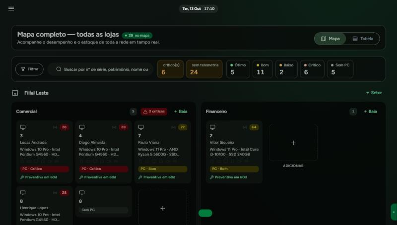
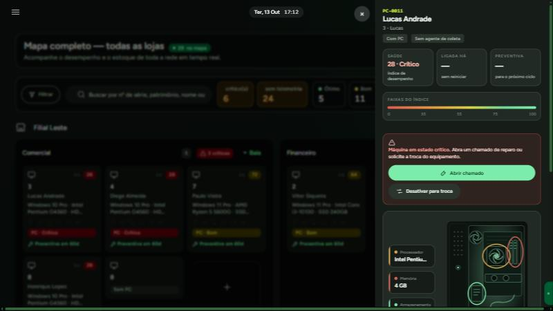
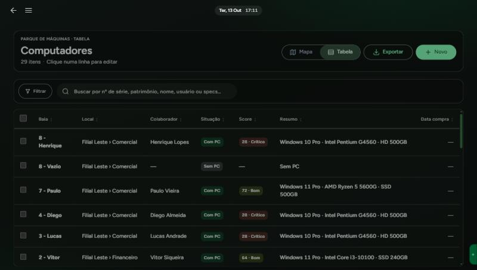
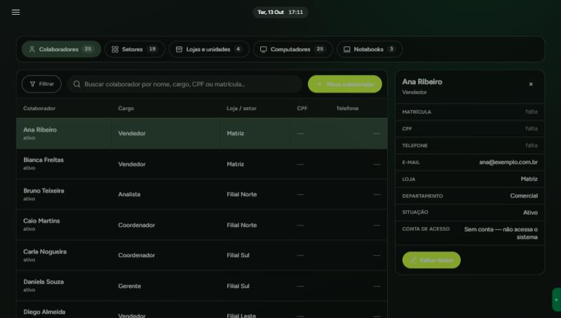

<div align="center">

# PatriMap

**Gestão de ativos de TI para uma rede de lojas**

Onde está cada máquina · quem usa · como ela está · o que já aconteceu com ela

<br>


</div>

---

> Este repositório é uma **vitrine da arquitetura**. O sistema roda em produção;
> o código de produção e os dados são privados. Nomes de pessoa que aparecem em
> testes e exemplos são fictícios.

## As telas

<table>
<tr>
<td width="50%"><br>
<b>Mapa do parque</b><br><sub>A planta da rede: loja → setor → baia. Cada mesa mostra quem senta,
a configuração da máquina e o índice de desempenho. Mesa vazia aparece vazia.</sub></td>
<td width="50%"><br>
<b>Ficha da máquina</b><br><sub>Clicar numa baia abre o equipamento: saúde, tempo ligado, preventiva,
e as ações possíveis. Máquina em estado crítico diz o que fazer.</sub></td>
</tr>
<tr>
<td><br>
<b>Parque em tabela</b><br><sub>O mesmo dado do mapa, para quem precisa filtrar, ordenar e exportar.
Mesa sem máquina continua na lista — ausência também é informação.</sub></td>
<td><br>
<b>Central de cadastros</b><br><sub>Colaboradores, setores, lojas, computadores e notebooks numa tela.
A ficha diz, inclusive, quando a pessoa <i>não</i> tem conta de acesso.</sub></td>
</tr>
</table>

<sub>Capturas de um ambiente de demonstração. Todos os nomes, lojas e números de
patrimônio são fictícios.</sub>

## O problema

Inventário de TI quase sempre começa numa planilha, e quase sempre morre nela.
Não por falta de coluna — por falta de **verbo**. A planilha registra um estado;
a operação é feita de acontecimentos.

A pessoa trocou de mesa. A mesa mudou de setor. A máquina foi para a assistência
e voltou com outro processador. O estagiário saiu e ninguém lembra para quem foi
o notebook dele. Cada um desses eventos invalida a planilha em silêncio — e seis
meses depois ninguém sabe dizer se o que está escrito ainda é verdade.

O PatriMap troca a pergunta *"o que está escrito?"* por *"o que aconteceu?"*.

A origem ainda está visível no código: o campo `usuario` do notebook guarda
texto livre **"como na planilha"**. É a cicatriz da migração — e a razão de
existirem comandos que casam o texto com o cadastro de verdade.

## A operação

| | |
|---|---|
| Lojas | 6 |
| Máquinas em operação | 161 (129 desktops · 32 notebooks) |
| Posições de trabalho | 143 |
| Colaboradores | 91 |

---

## As regras do negócio

### 1. Onde a máquina está, e de quem ela é

A unidade de localização é a **baia**: uma mesa. Ela existe para responder
*"onde eu acho esta máquina na empresa?"*, e nada mais.

- Todo computador fica numa baia.
- Uma baia tem **no máximo um** dispositivo: computador **ou** notebook.
- Uma baia pode estar vazia, e pode ter máquina sem ninguém usando.
- Quem ocupa a baia é quem usa a máquina.
- **Tirar a pessoa deixa o computador na mesa, sem ninguém.** A máquina não
  "volta para o estoque" só porque alguém saiu — ela continua fisicamente ali.
- Tirar a máquina da mesa manda ela para o estoque, e ela **deixa de ter dono**:
  equipamento em prateleira não pertence a ninguém.

**O notebook segue regra diferente, e isso é deliberado.** Notebook acompanha a
*pessoa*, não a mesa — é a camada móvel do colaborador. Mesa com colaborador e
sem desktop puxa automaticamente o notebook dele.

**Todo colaborador ativo aparece no mapa, mesmo sem equipamento.** Pedido da
gerência: quem não tem máquina é exatamente quem precisa ser visto, não quem
some do relatório.

### 2. Ciclo de vida do equipamento

```
Em estoque  →  Em uso  →  Em estoque
                  ↓
            Com defeito  →  Desativado
```

O status acompanha a alocação sozinho: entrou na baia, está em uso; saiu, volta
ao estoque. **"Com defeito" e "Desativado" são decisões de gente, e o sistema
não as atropela** — uma máquina quebrada não vira "em estoque" porque alguém
mexeu na mesa.

O **número de patrimônio é gerado pela loja** no momento do cadastro, com
etiqueta (código de barras e QR) pronta para impressão.

### 3. Manutenção: do chamado à máquina de volta

```
Chamado aberto → Orçamento → Aprovação → Assistência externa → Retorno
```

- **Chamado** tem tipo: reparo, upgrade, preventiva, troca de periférico ou
  desativação para troca.
- **Orçamento** nasce do chamado e vai para aprovação: *pendente → aprovado /
  negado*. Nada é enviado para conserto sem decisão registrada.
- **Assistência externa** tem rastreamento próprio: *enviado → em análise →
  aguardando aprovação → em reparo → retornando → finalizado*, com devolutiva
  (vai reparar / sem conserto).
- **Reparo de upgrade reescreve as specs da máquina.** Trocou o SSD? O cadastro
  passa a dizer SSD — senão o inventário envelhece a cada conserto.
- Cada reparo incrementa o contador da máquina. É esse histórico que sustenta o
  **índice de desempenho** (Crítico · Baixo · Bom · Ótimo), que responde a
  pergunta cara: *"vale consertar de novo ou é hora de trocar?"*

### 4. Preventiva

Manutenção preventiva tem calendário e vencimento. Adiar é possível — e **o
adiamento passa por aprovação**, porque "depois eu faço" é como a preventiva
deixa de existir.

### 5. Movimentação entre lojas

Transferir máquina entre unidades é transação de verdade: a baia de origem não
pode ficar com a máquina que já saiu, nem a de destino sem a que chegou. O
estado intermediário não existe — ou a movimentação acontece inteira, ou não
acontece.

Toda transferência emite **protocolo impresso** para assinatura.

### 6. Documento é obrigação, não anexo opcional

Cada equipamento tem um **dossiê**: nota fiscal de compra, nota de serviço,
termo assinado, laudo técnico, ordem de serviço, orçamento aprovado.

O sistema **cobra o que falta** em vez de esperar alguém lembrar. Entrega de
notebook gera **termo de responsabilidade**; a devolução gera o termo de
devolução, e subir o termo assinado fecha a pendência sozinho.

### 7. Telemetria: conferir sem sobrescrever

Um agente instalado nas máquinas coleta configuração real (CPU, RAM, disco, S.O.,
tempo ligado). A regra de conflito é explícita:

> **O cadastro manda na tela. A divergência é mostrada, não escondida.**

Se o cadastro diz 8 GB e a máquina reporta 4 GB, a tela mostra os dois lado a
lado. Escolher um em silêncio seria trocar um erro visível por um invisível — e
é gente que decide qual dos dois está errado.

### 8. Pessoas, acesso e desligamento

- **Existir no cadastro e entrar no sistema são coisas separadas.** Quem só
  recebe equipamento não precisa de login.
- Acesso é concedido **por tela**, através de cargos — e existe uma trava contra
  promoção: ninguém concede um acesso que ele próprio não tem.
- **Desligar alguém fecha a porta no mesmo instante.** A sessão aberta cai no
  próximo clique. O cadastro e o histórico ficam — desativar não apaga nada.
- Devolver acesso é decisão explícita de quem administra. Religar o cadastro
  **não** religa a conta: fechar errado se conserta num clique, abrir errado
  ninguém fica sabendo.

### 9. O mural: o que aconteceu hoje

Feed de acontecimentos do parque — chamados, movimentações, aprovações,
avisos — com uma regra de visibilidade que não se negocia:

> Um acontecimento só entra no feed de alguém se essa pessoa **já podia abrir a
> tela que mostrava aquele acontecimento**.

Não existe segunda lista de permissão para manter em dia. E ler não é escrever:
toda a equipe acompanha, um grupo menor publica.

---

## O que mudou na prática

**Localizar uma máquina deixou de ser uma pergunta para alguém.** Antes: "quem
sabe onde está o PC que era do financeiro?". Agora: loja → setor → baia, com
planta visual por unidade.

**"De quem é esta máquina?" passou a ter resposta sempre** — inclusive quando
ela está no estoque ou no conserto, que é justamente quando a planilha emudece.

**Conserto virou processo com decisão registrada.** Quem autorizou, por quanto,
em que data, e o que a assistência respondeu. Antes isso vivia em conversa de
WhatsApp, e a resposta se perdia.

**O inventário para de envelhecer sozinho.** Upgrade atualiza as specs; reparo
conta no histórico; telemetria confere o que foi digitado.

**Troca de máquina deixou de ser palpite.** O índice de desempenho junta idade,
configuração e histórico de reparos num número — a conversa com a diretoria
passa a ser sobre dado, não sobre impressão.

**Desligamento deixou de ser risco em aberto.** Enquanto o acesso dependia de
alguém lembrar de abrir outra tela, contas de quem já tinha saído continuavam
ativas.

> *Os ganhos acima são de processo. Números de tempo e custo pertencem à empresa
> e não são publicados aqui.*

---

## Três decisões difíceis

**O dado mora no bem, não só na relação.** O vínculo computador↔colaborador é
espelhado no próprio computador, mesmo a baia já sabendo quem senta nela. Sem
isso, "de quem é esta máquina" só tem resposta passando pela mesa — e máquina
fora de mesa não responde.

**O automatismo não chuta.** Os comandos que casam dados importados **só
relatam** por padrão; gravam com `--aplicar`. Uma baia escrita como *"2 - Paula
Andrade"* quase foi ligada a uma *"Paula Moreira"* porque o desempate por loja
atropelava o sobrenome. São pessoas diferentes. Hoje, com sobrenome escrito e
sem cadastro correspondente, o sistema diz "sem ficha" em vez de adivinhar.

**Toda regra automática está escrita num só lugar.** São 26 regras que rodam
sozinhas ao salvar um registro — salvar uma baia dispara nove delas. Cada uma
facilita o dia normal e fecha uma porta no dia anormal. Elas vivem num
documento que diz, para cada uma: o que faz, **o que impede**, e qual é a saída.

---

## Stack e organização

Django 5.2 · Python 3.12 · SQLite em modo WAL · Material Design 3 implementado
do zero, sem framework de componentes · 245 testes.

```
apps/
  orgs/        pessoas, lojas, setores, contas de acesso, permissões
  parque/      baias, computadores, notebooks, peças, reparos, mural
  catalog/     fabricantes, modelos, fornecedores
  inventory/   ativos genéricos e atribuições
  maintenance/ manutenções e garantias
  orcamentos/  aprovação de orçamento de reparo
config/settings/   base · dev · prod · servidor · tunnel
```

```bash
python -m venv .venv && .venv/Scripts/activate
pip install -r requirements.txt
cp .env.example .env          # ajuste SECRET_KEY e DATABASE_URL
python manage.py migrate && python manage.py createsuperuser
python manage.py runserver
```

---

<div align="center">
<sub>Projeto desenvolvido para uso interno corporativo.<br>
Publicado como vitrine técnica, sem dados reais.</sub>
</div>
